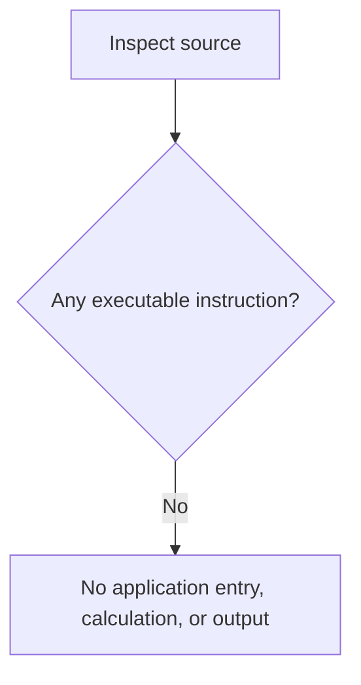

# Empty Assembly Templates

[Repository overview](../../README.md) · [Compare implementations](../README.md)

Preserve an empty or directive-only assembly file as an incomplete exercise.

**Implementation:** Origin And End Only

**Input:** none.  
**Output:** none.

## Inputs and results

| Parameter | Description |
| --- | --- |
| Input | No executable input path |
| Output | No program-defined output |

## Worked example

There are no application instructions to run, so there is no numerical input/output demonstration.

### Calculation details

Open the source and look for an executable instruction. There is no application path to step through. A reset therefore has no input-to-output example defined by this file.

## Program operation

### Functional flowchart

[Detailed control flow](Control%20Flow.md)

### Simplified block diagram

This file has no executable input, processing, or output blocks.

[Assembly source](source.asm)
